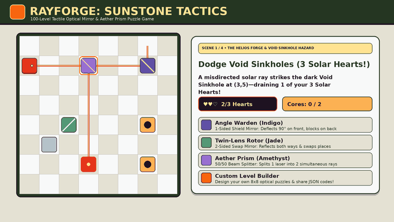

# RAYFORGE: Sunstone Tactics (100-Level Game Off 2026 — "SHIFT" Edition)

**RAYFORGE: Sunstone Tactics** is a tactile, zero-dependency 100-level HTML5 optical laser-and-prism strategy puzzle game built for [GitHub Game Off 2026](https://itch.io/jam/game-off-2026) under the official theme **SHIFT**.

## How RAYFORGE Interprets the "SHIFT" Theme
1. **Phase-Angle Shift (90°):** Rotate 1-sided **Angle Wardens** (`#5E4FAD`) to shift the solar ray 90° while blocking stray beams on their armored backs.
2. **Spatial Tile Shift (Swap):** Use 2-sided **Twin-Lens Rotors** (`#529574`) to swap positions directly with adjacent optical units.
3. **Optical Wavelength Shift (50/50 Split):** Route beams through **Aether Prisms** (`#986BE2`) to split a single solar ray into two simultaneous beams and ignite every **Sunstone Core (★)** while avoiding **Void Sinkholes (☠)**.

## Features
- **100 Guaranteed-Solvable Levels across 5 Worlds**
- **3-Heart Void Sinkhole Hazard System**
- **Built-In Custom Level Builder with Shareable JSON Codes**
- **Procedural Web Audio API Synthesizer (Zero External Audio Dependencies)**

## Controls
- **Move / Swap:** Tap/Click a unit, then tap an adjacent highlighted tile (or use `WASD` / Arrow Keys)
- **Rotate 90°:** Tap a selected unit again, click `↻ Rot Right` / `↺ Rot Left`, or press `R` / `Q`
- **Undo:** Click `↶ Undo` or press `Z`
